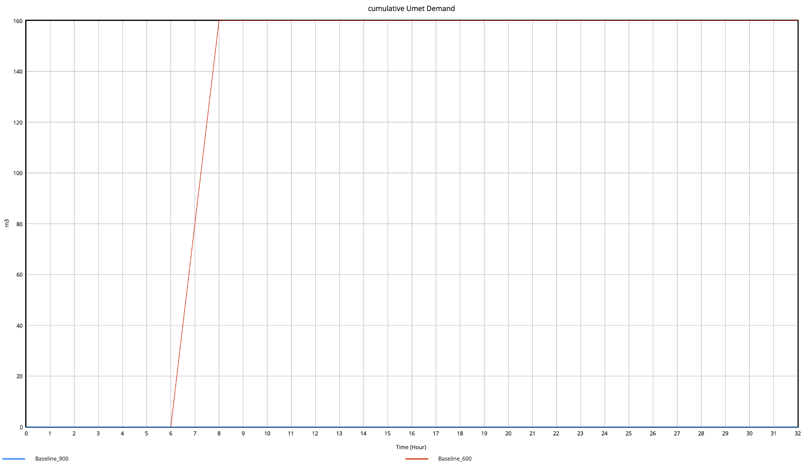
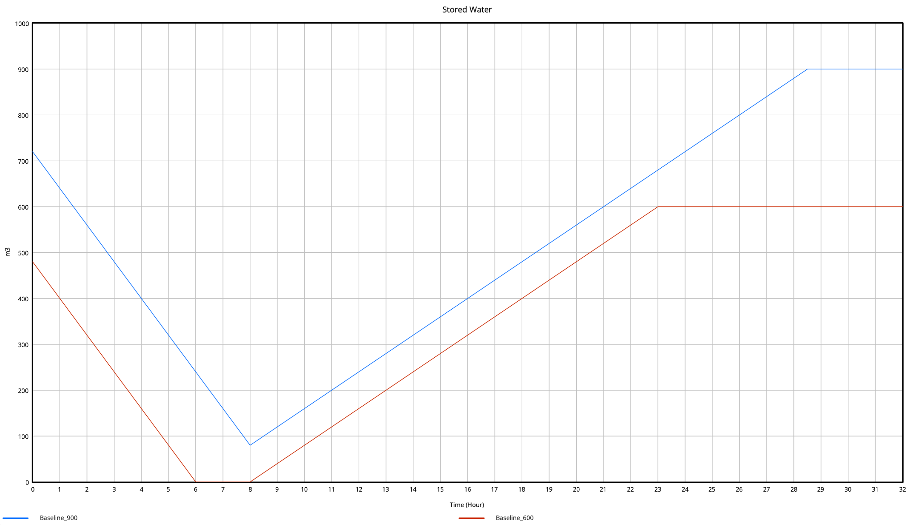
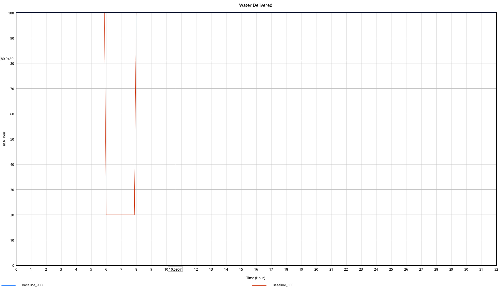

# Water Resilience Lab

A system dynamics experiment in Vensim examining how storage affects water service continuity during an eight-hour supply interruption in a synthetic drinking-water system.

## Results

| Metric | Baseline | Expanded storage |
|---|---:|---:|
| Tank capacity | 600 m³ | 900 m³ |
| Starting inventory (80% full) | 480 m³ | 720 m³ |
| Inventory when supply returned at hour 8 | 0 m³ | 80 m³ |
| Cumulative unmet demand | 160 m³ | 0 m³ |
| Time to rebuild starting reserves after supply returned | 12 hours | 16 hours |

The expanded tank met full demand throughout the event. The baseline delivered just 20 of the required 100 m³/hour from hour 6 until hour 8. The expanded tank drew down 640 m³ compared with 480 m³ for the baseline, so it took four more hours to replenish its starting reserve at the same 40 m³/hour net refill rate.

## Model and reproduction

Open [water-resilience-lab.mdl](water-resilience-lab.mdl) in Vensim. The saved model defaults to 900 m³. Run from hour 0 to 32 using Euler integration and a time step and save interval of 0.125 hour. Set community demand to 100 m³/hour and treated inflow to 20 m³/hour until hour 8, then 140 m³/hour. Run once with each tank capacity and keep the initial fill fraction at 0.8.

The model starts the stored-water stock at capacity multiplied by fill fraction. At each step, delivery is limited by demand and the water available from inflow plus storage. Overflow removes excess water once capacity is reached. Cumulative unmet demand integrates the difference between demand and delivery.

The model labels the cumulative metric `cumulative Umet Demand`. The CSVs use the corrected column heading `Cumulative Unmet Demand`.

The [baseline CSV](baseline_600.csv) and [expanded-storage CSV](expanded_900.csv) contain the verified Vensim outputs, with one row per time step. Check starting inventory at hour 0, remaining inventory at hour 8, and cumulative unmet demand at hour 32.

## Vensim results

The original Vensim legends identify the 600 m³ baseline as `Baseline_600` and the 900 m³ expanded tank as `Baseline_900`.

### Cumulative unmet demand

### Stored water

### Water delivered

## Scope

This synthetic water-balance experiment illustrates service continuity and reserve recovery under an imposed supply reduction. It assumes uniform demand and fully usable storage. Site-specific decisions would require hydraulic, pressure, water-quality, and operational data.
